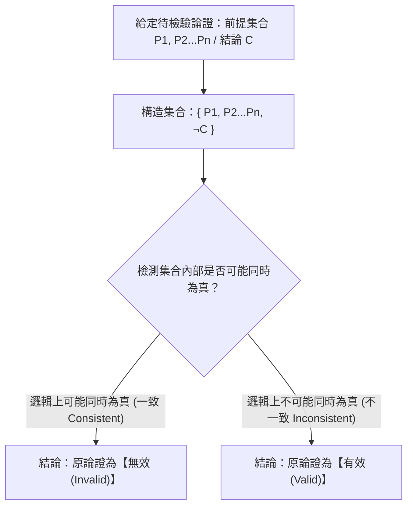

# 一致性 (Consistency) 與 有效性檢測

在邏輯學中，「一致性」是針對**一個陳述句集合 (A set of statements)** 的核心語意性質，並且是檢驗論證[[有效性與健全性|形式有效性]]的一項強大工具。

---

## 1. 一致性與不一致性的定義

一致性並非描述單一語句，而是描述**一群語句構成的集合**：

- **一致的 (Consistent)**：
  - 一個陳述句集合是**一致的**，若且唯若：**在邏輯上可能 (logically possible) 該集合中的所有語句同時為真**。
- **不一致的 (Inconsistent)**：
  - 一個陳述句集合是**不一致的**，若且唯若：集合內部的成員之間存在矛盾（Contradiction），**在邏輯上不可能所有語句在同一時間皆為真**。
- **形式決定**：如同論證有效性一樣，集合的一致與否同樣由語句的邏輯形式決定。

### 1.1 經典範例
- **符號範例（顯然不一致）**：
  $$\{p \land q,\ \neg p,\ \neg q\}$$
  （若 $p \land q$ 為真，則 $p$ 必為真，但第二個語句斷定 $p$ 為假，構成矛盾）
- **哲學/歷史範例（甘迺迪道德悖反集合）**：
  1. 約翰·甘迺迪（J.F. Kennedy）是一位具有崇高道德品格的人。
  2. 約翰·甘迺迪經常通姦出軌。
  3. 沒有任何經常通姦出軌的人具有崇高道德品格。
  $\rightarrow$ 這三句話所構成的集合是**邏輯上不一致的**（三者不可能同時為真）。
- **隱含不一致（理髮師悖論 Barber Paradox）**：
  > 「理髮師哈利只給村裡所有不給自己刮鬍子的人刮鬍子。」  
  > 提問：哈利給不給自己刮鬍子？若給自己刮，依定義他不應給自己刮；若不給自己刮，依定義他必須給自己刮。此集合內部隱含矛盾。

---

## 2. 一致性與有效性的深刻關聯 (The Fundamental Equivalence)

演繹論證的有效性與陳述句集合的不一致性，本質上互為一體兩面：

1. **有效論證唯一排除的狀況**：前提全部為真，但結論為假（即**前提全真且「結論的否定」為真**）。
2. **不一致集合唯一排除的狀況**：集合中所有的陳述**全部同時為真**。

### 核心等價定理：
$$\text{論證是有效的 (Valid)} \iff \{\text{所有前提}\} \cup \{\neg\text{結論}\} \text{ 所構成的集合是「不一致的 (Inconsistent)」}$$

換言之：
> **An argument is valid if and only if it is inconsistent to say that all its premises are true and its conclusion is false.**

---

## 3. 一致性檢測法 (Consistency Test for Validity)

藉由上述等價定理，我們可以把任何論證的有效性檢驗，轉換為集合的一致性檢測：

### 3.1 課堂經典檢測示範（死刑廢除論證）
- **原論證**：
  1. 如果死刑不比無期徒刑更有嚇阻作用，則死刑應該被廢除。($P \rightarrow Q$)
  2. 死刑不比無期徒刑更有嚇阻作用。($P$)
  $\therefore$ 3. 死刑應該被廢除。($Q$)
- **檢測步驟**：
  - 將「結論的否定（$\neg Q$：死刑不應該被廢除）」加入前提集合：
    $$\{P \rightarrow Q,\ P,\ \neg Q\}$$
  - 由前提 1 與前提 2 依[[假言推理_Modus_Ponens|MP]]可推得 $Q$。
  - $Q$ 與 $\neg Q$ 形成直接矛盾（$Q \land \neg Q$），邏輯上不可能同時成立。
  - 因此該集合是**不一致的 (Inconsistent)**。
- **檢驗結果**：原論證被確認為**形式有效 (Valid)**！

---

## 4. 相關鏈結

- 演繹基礎：[[有效性與健全性]]、[[論證與陳述句]]
- 推論規則：[[假言推理_Modus_Ponens]]、[[選言三段論_Disjunctive_Syllogism]]
- 證明技術：[[自然演繹法_Natural_Deduction]]（歸謬法 IP 正是基於此原理）
- 知識地圖：[[邏輯學知識體系地圖]]
