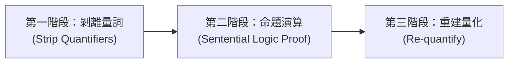

# 述詞邏輯演繹證明法 (Predicate Deduction)

述詞邏輯證明法將語句邏輯的自然演繹體系擴展至量化命題，形成一套能夠精確推導個體與性質內在結構的強大工具。

---

## 1. 完整規則庫組成結構

述詞邏輯的演繹證明建立在三大規則支柱上：
1. **語句邏輯 18 條規則 ＋ CP ＋ IP**（完全繼承）。
2. **量詞推論四規則**：[[量詞推論四規則_UI_UG_EI_EG|UI, UG, EI, EG]]。
3. **量詞等值規則**：[[量詞否定規則_QN]]。
4. **等同專用規則**（若論證涉及等號）：[[等同規則與反身律_ID_and_IR|ID 與 IR]]。

---

## 2. 標準三階段解題戰略流程



### 階段一：消去量詞 (Strip Quantifiers)
1. **先用 QN 打開所有否定量詞**：若看到 $\neg(x)$ 或 $\neg(\exists x)$，第一時間用 QN 轉化為正向形式。
2. **「先做 EI，再做 UI！」（鐵律）**：
   - 若前提中同時存在全稱語句與存在語句，**必須優先對存在語句做 EI**，引進全新準變元（例如 $x$）。
   - 隨後，再對全稱語句做 UI，**主動挑選同一個變元 $x$ 進行代換**，使兩者能在命題演算階段完美相遇！

### 階段二：命題演算推導 (Sentential Proof)
- 利用 MP, MT, HS, DS, DeM, Simp, Conj 等經典規則，在個體層次推導出目標性質。

### 階段三：添加量詞 (Re-quantify)
1. **若結論是全稱句**：檢查推導出的變元是否符合 UG 的 3 項嚴格限制（未被常元污染、非 EI 引進、不在未解除 AP 中），合法使用 **UG**。
2. **若結論是存在句**：直接合法使用 **EG**。

---

## 3. 典型例題逐步示範

**題目**：證明 $(x)(Ax \rightarrow Bx),\ (\exists x)Ax \vdash (\exists x)Bx$

```markdown
前提：
1. (x)(Ax -> Bx)               (前提，全稱句)
2. (∃x)Ax                      (前提，存在句)  /∴ (∃x)Bx

證明步驟：
3. Ax                          (2 EI，★先做 EI，引進全新準變元 x)
4. Ax -> Bx                    (1 UI，★後做 UI，配合挑選 x)
5. Bx                          (3, 4 MP，命題演繹推導)
6. (∃x)Bx                      (5 EG，添加存在量詞)
Q.E.D.
```

---

## 4. 相關鏈結

- 規則細節與禁忌：[[量詞推論四規則_UI_UG_EI_EG]]
- 雙向轉換工具：[[量詞否定規則_QN]]
- 習題精解：[[ex_002_述詞邏輯演繹推導與量詞規則限制]]
- 知識地圖：[[邏輯學知識體系地圖]]
